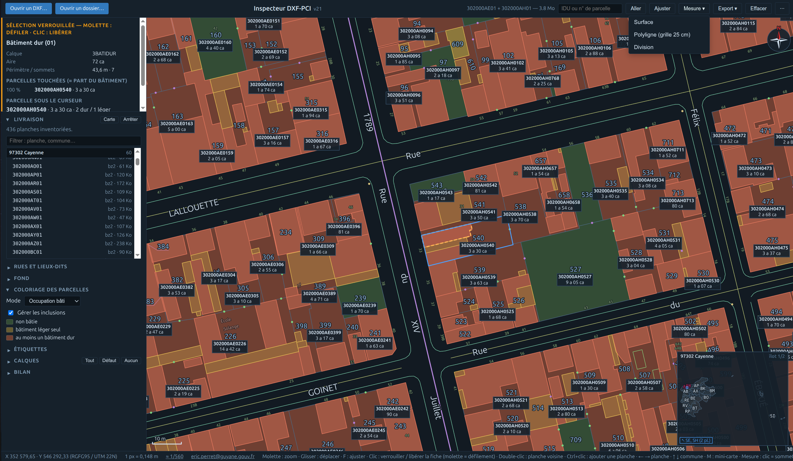

<!--
  ============================================================================
  FICHIER  : README.md
  VERSION  : v21
  DATE     : 09/10/2026
  AUTEUR   : Eric PERRET
  OBJET    : Présentation du projet cadastre_dxf_inspecteur pour GitHub.
  ============================================================================
-->

# Inspecteur DXF-PCI

Visionneuse et outil de travail pour les planches du **Plan Cadastral Informatisé (PCI) au format DXF** publiées par la DGFiP sur [cadastre.data.gouv.fr](https://cadastre.data.gouv.fr/data/dgfip-pci-vecteur/).

Fichier unique `cadastre_dxf_inspecteur_v21.html` : aucune installation, aucune librairie, aucun serveur. Il s'ouvre dans un navigateur et fonctionne hors ligne. Les fichiers DXF sont lus localement, rien n'est envoyé.

Conçu pour les géomètres et les services fonciers, utilisable par tout service ayant besoin de localiser rapidement une parcelle, une rue ou un numéro de voie.

*Cayenne, planches 302000AE01 et 302000AH01 affichées ensemble (Ctrl+clic), coloriage par occupation bâtie, fiche verrouillée d'un bâtiment dur et de sa parcelle, mini-carte de la commune.*

## Démarrage

1. Télécharger le `.zip` d'un département sur  
   `https://cadastre.data.gouv.fr/data/dgfip-pci-vecteur/<millésime>/dxf/departements/`
2. Le dézipper.
3. Ouvrir `cadastre_dxf_inspecteur_v21.html` dans un navigateur récent (Firefox, Chrome, Edge).
4. **Ouvrir un dossier…** et pointer le répertoire racine des planches (`dep973/`, `97302/`…).  
   La première planche de la première commune s'affiche aussitôt.

Une planche isolée (`.DXF` ou archive `.tar.bz2`) s'ouvre aussi par **Ouvrir un DXF…** ou par glisser-déposer.

## Fonctions

### Lecture de la planche
- Parcelles, bâtiments durs, légers et vus du ciel, trous, sections et subdivisions, textes à leur place et à leur échelle.
- Coloriage des parcelles : occupation bâtie (non bâtie / léger / dur) ou voisinage (deux voisines jamais de même couleur), gestion des parcelles incluses.
- Étiquettes XDATA : IDU, contenance SUPF, IDU des sections.
- Fiche complète au survol : XDATA, aire et périmètre calculés, voisines, bâtiments par parcelle, parcelles touchées par un bâtiment avec leur part en %.
- Recherche par IDU ou numéro de parcelle.

### Livraison départementale
- Lecture d'un dossier de livraison : archives `.tar.bz2` décompressées dans le navigateur, liste des planches par commune (34 969 communes de France intégrées).
- Carte de synthèse du département, mini-carte de la commune, contours des planches voisines.
- Inventaire de la planche et de la livraison, confronté à la norme DXF-PCI (calques hors norme, primitives non conformes, calques absents), copie en TSV.

### Rues et lieux-dits
- Index automatique de la commune affichée : noms de voies (3ZONCOMMTEX), axes (1ZONCOMM), lieux-dits (3LIEUDITTEX, 1LIEUDIT), numéros de voie (3NUMVOIE).
- Noms classés sous la forme « Lilas (rue des) », doublons fusionnés.
- Clic sur une rue : cadrage début-fin et liste de ses numéros. Clic sur un numéro : cadrage centré sur le numéro.

### Mesure et production
- **Surface** et **polyligne** magnétiques (sommets et blocs des calques visibles, grille 25 cm), aires en ha a ca, longueurs, gisement en degrés et grades.
- **Division assistée** : lot de contenance donnée, ligne parallèle à un côté ou pivot sur un sommet.
- **Exports** : DA géomètre (`_danum.txt` et `_lever.txt` dans un `.zip`), PNG de la vue à l'échelle 1/N, GeoJSON pour QGIS.
- Échelle normalisée cliquable (1/100 à 1/1 000 000), fond Google photo ou plan recalé dans la projection de la planche.

## Commandes

| Geste | Action |
|---|---|
| Molette | Zoom |
| Glisser | Déplacer la vue |
| Clic sur un objet | Verrouiller la fiche (la molette fait alors défiler la fiche) ; nouveau clic : libérer |
| Double-clic sur une planche voisine | Ouvrir cette planche (vue conservée) |
| Ctrl+clic sur une planche voisine | L'ajouter à l'affichage ou l'en retirer |
| ← → | Planche précédente / suivante de la commune |
| ↑ ↓ | Commune précédente / suivante |
| F | Ajuster la vue |
| M | Afficher / masquer la mini-carte |
| + / − | Zoom |
| Échap | Libérer la sélection, fermer l'inventaire, quitter un outil |
| Mesure : clic / clic droit / Suppr / Alt | Poser un sommet / clore la pose / effacer le sommet / sans aimant |

## Projections reconnues

Coordonnées affichées telles que livrées. Le libellé et le recalage du fond sont déduits des coordonnées :

- **RGFG95 / UTM 22N** (EPSG 2972) en Guyane ;
- **RGF93 / Lambert-93** (EPSG 2154) en métropole et en Corse.

Les mesures sont planes dans la projection (surface « fiscale », comparable à la SUPF).

## Données et confidentialité

- Les planches restent sur le poste : lecture, décompression et calculs se font dans le navigateur.
- Seul le **fond Google** (désactivé par défaut) appelle un service externe ; son usage est soumis aux conditions de Google.
- Les préférences d'affichage (sections repliées) sont mémorisées dans le `localStorage` du navigateur.

## Limites connues

- Rattachement bâti → parcelle et numéro → rue par calcul géométrique : les parts en % et les rattachements sont approchés.
- Un même nom de voie présent à deux endroits éloignés de la commune est regroupé en une seule entrée.
- Navigateur récent requis (JavaScript, canvas 2D, `TextDecoder`).

## Auteur

Eric PERRET — Mission Foncier, Guyane — eric.perret@guyane.gouv.fr
