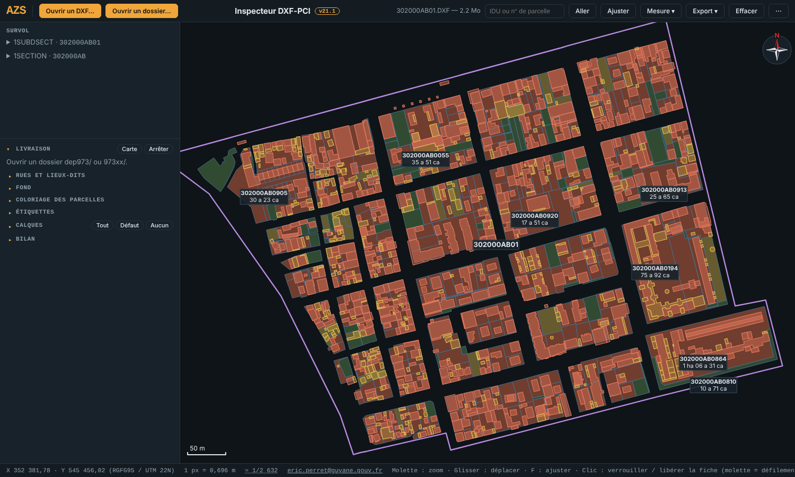

<!--
  ============================================================================
  FILE     : README.md
  VERSION  : v21.2
  DATE     : 18/10/2026
  AUTHOR   : Eric PERRET
  PURPOSE  : Overview of the cadastre_dxf_inspecteur project for GitHub.
  ============================================================================
-->

# DXF-PCI Inspector

🇫🇷 [Version française : LISEZMOI.md](LISEZMOI.md)

▶️ **[Launch the inspector](https://ericperret.github.io/cadastre/cadastre_dxf_inspecteur_v21.html)** — sheets are read on your computer, nothing is uploaded.

Viewer and working tool for the sheets of the French **computerised cadastral map (PCI, Plan Cadastral Informatisé) in DXF format**, published by the DGFiP (French tax administration) on [cadastre.data.gouv.fr](https://cadastre.data.gouv.fr/data/dgfip-pci-vecteur/).

Single file `cadastre_dxf_inspecteur_v21.html`: no installation, no library, no server. It opens in a browser and works offline. DXF files are read locally, nothing is sent anywhere.

User interface in French (the DXF-PCI standard and its layer names are French).

Eric PERRET — French Guiana — personal project, developed on personal time, drawing on professional experience in land management, usable by any office that needs to quickly locate a parcel, a street or a street number.

*Cayenne, sheets 302000AE01 and 302000AH01 displayed together (Ctrl+click), parcels coloured by built occupation, locked record of a permanent building and its parcel, municipality mini-map.*

*Sample sheet `302000AB01.DXF` provided in the repository.*

## Getting started

1. Download a département `.zip` from  
   `https://cadastre.data.gouv.fr/data/dgfip-pci-vecteur/<release>/dxf/departements/`
2. Unzip it.
3. Open the link above, or the downloaded `cadastre_dxf_inspecteur_v21.html`, in a recent browser (Firefox, Chrome, Edge).
4. **Ouvrir un dossier…** (open a folder) and select the root directory of the sheets (`dep973/`, `97302/`…).  
   The first sheet of the first municipality is displayed at once.

A single sheet (`.DXF` or `.tar.bz2` archive) can also be opened with **Ouvrir un DXF…** (open a DXF) or by drag and drop. To try it right away: `302000AB01.DXF`, provided in the repository.

## Features

### Reading a sheet
- Parcels, permanent, light and aerial-view buildings, holes, sections and subdivisions, texts at their position and scale.
- Parcel colouring: built occupation (unbuilt / light / permanent) or neighbourhood (two neighbours never share a colour), nested parcels handled.
- XDATA labels: IDU (parcel identifier), SUPF area, section IDU.
- Full record on hover: XDATA, computed area and perimeter, neighbours, buildings per parcel, parcels touched by a building with their share in %.
- Search by IDU or parcel number.

### Département delivery
- Reading a delivery folder: `.tar.bz2` archives decompressed in the browser, list of sheets per municipality (34,969 French municipalities built in).
- Overview map of the département, municipality mini-map, outlines of neighbouring sheets.
- Inventory of the sheet and of the delivery, checked against the DXF-PCI standard (non-standard layers, non-compliant primitives, missing layers), TSV copy.

### Streets and localities
- Automatic index of the displayed municipality: street names (3ZONCOMMTEX), street axes (1ZONCOMM), localities (3LIEUDITTEX, 1LIEUDIT), street numbers (3NUMVOIE).
- Names sorted as « Lilas (rue des) », duplicates merged.
- Click on a street: start-to-end framing and list of its numbers. Click on a number: view centred on the number.

### Measurement and output
- Snapping **area** and **polyline** tools (vertices and blocks of visible layers, 25 cm grid), areas in ha a ca, lengths, bearing in degrees and grads.
- **Assisted division**: lot of a given area, line parallel to a side or pivoting on a vertex.
- **Exports**: surveyor DA (`_danum.txt` and `_lever.txt` in a `.zip`), PNG of the view at scale 1/N, GeoJSON for QGIS.
- Clickable standard scale (1/100 to 1/1,000,000), Google photo or map background registered in the sheet's projection.

## Controls

| Gesture | Action |
|---|---|
| Wheel | Zoom |
| Drag | Pan the view |
| Click on an object | Lock the record (the wheel then scrolls the record); click again: release |
| Double-click on a neighbouring sheet | Open that sheet (view kept) |
| Ctrl+click on a neighbouring sheet | Add it to or remove it from the display |
| ← → | Previous / next sheet of the municipality |
| ↑ ↓ | Previous / next municipality |
| F | Fit the view |
| M | Show / hide the mini-map |
| + / − | Zoom |
| Esc | Release the selection, close the inventory, leave a tool |
| Measure: click / right-click / Del / Alt | Add a vertex / finish / delete the vertex / no snapping |

## Supported projections

Coordinates are displayed as delivered. The label and the background registration are deduced from the coordinates:

- **RGFG95 / UTM 22N** (EPSG 2972) in French Guiana;
- **RGF93 / Lambert-93** (EPSG 2154) in mainland France and Corsica.

Measurements are planar in the projection ("fiscal" area, comparable to SUPF).

## Data and privacy

- Sheets stay on the computer: reading, decompression and computation happen in the browser.
- Only the **Google background** (off by default) calls an external service; its use is subject to Google's terms.
- Display preferences (collapsed sections) are stored in the browser's `localStorage`.

## Known limitations

- Building → parcel and number → street links are computed geometrically: shares in % and links are approximate.
- The same street name found in two distant places of the municipality is grouped into a single entry.
- A recent browser is required (JavaScript, 2D canvas, `TextDecoder`).

## License

**Free for non-commercial use** — [CC BY-NC 4.0](https://creativecommons.org/licenses/by-nc/4.0/), with mandatory credit of the source and the author:

> cadastre — Eric PERRET — https://github.com/ericperret/cadastre

Any commercial use is forbidden without the author's written permission, requested by e-mail: **eperret@azs.fr**.
Full terms (French / English): [LICENSE](LICENSE).

## Author

Eric PERRET — eperret@azs.fr — [www.azs.fr](https://www.azs.fr/)

v21.1 (18/10/2026): AZS visual identity (slate / amber / cyan palette, AZS mark linking back to www.azs.fr); cartographic colours unchanged.
v21.2 (18/10/2026): footer contact changed to eperret@azs.fr (personal development).
